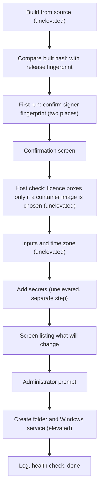

# Installer framework: architecture

Private until the operator publishes it. Architecture description in the manner of ISO/IEC/IEEE 42010 (context, building blocks, views, rationale); no clause number is cited. Requirements: [srs.md](./srs.md). Decisions: [decisions.md](./decisions.md). Evidence tags: OBSERVED (seen in a source), INFERRED (reasoning), UNVERIFIED (not checked). Untagged lines restate a decision.

## 1. Context

Contributors and partners build an NSIS installer from public source on their own PC and run it, interactively or silently, to give the inputs it needs (D-R1-3, D-R1-4). Nobody receives a binary from us (D-R1-2). Each partner owns a private GitHub, GitLab, both, or neither (D-R2-2). The signer (the operator) publishes only a signed release with the expected fingerprint (D-R2-6).

| Actor | Role |
|-------|------|
| Signer | Signs releases and publishes the expected fingerprint in two independent places. |
| Contributor or partner | Builds from source, confirms the fingerprint, runs the installer on a PC, may suggest changes by pull request only (vision, D-R1-2; D-R6-9). |
| Extension | VS Code extension: one command builds and starts the installer after a confirmation screen; notifies of updates; never fetches or runs installer code on update (D-R3-2, D-R5-6). |
| Forge | The partner's own GitHub or GitLab, which holds the runner registration. |
| PC | The target Windows machine. May hold customer data (D-R4-7). |

## 2. Building blocks

| Id | Block | Responsibility | Requirements |
|----|-------|----------------|--------------|
| ARCH-1 | Trust chain | Signed release, published fingerprint, first-run comparison, stored signer, key replacement. | INST-REQ-001 to 006, 056 to 059 |
| ARCH-2 | Build script | Downloads and verifies NSIS 3.10, checks Git and container engine, compiles with fixed inputs, compares the hash. | INST-REQ-005 to 015 |
| ARCH-3 | Input schema | One schema generates the screens and the silent keys; secrets never on a command line, and silent mode takes none (D-R6-2). | INST-REQ-020 to 026 |
| ARCH-4 | Host check | Edition gate (only the listed editions pass; every other edition is refused with a plain reason, D-R6-6), licence screens (only when a container image is chosen, D-R6-8), the harmless "will it work?" check. Needs no administrator rights. | INST-REQ-016 to 019, 033 |
| ARCH-5 | Elevation moment | The screen before the administrator prompt; everything before it is unelevated. | INST-REQ-027 to 029 |
| ARCH-6 | Footprint | One folder under the machine's program-data location, one Windows service under a dedicated virtual service account and one uninstall entry (D-R6-4, D-R6-13); nothing else read or changed. | INST-REQ-030 to 032 |
| ARCH-7 | Runner modes | GitHub runner, "Local only (no forge)", GitLab runner; a second forge on a PC is refused (D-R6-12). | INST-REQ-034 to 036, 066 |
| ARCH-8 | Update, rollback, repair | Version state file, backup, swap, health check (service running for a fixed time; in forge modes the runner also online at the forge, D-R6-10), restore, repair mode. | INST-REQ-037 to 042 |
| ARCH-9 | Uninstall | Offline removal; the "still to do at the forge" list. | INST-REQ-043 to 045 |
| ARCH-10 | Logs and diagnostics | Step log; allow-list diagnostics zip written locally. | INST-REQ-046 to 050 |
| ARCH-11 | Time zone | Zone name stored; display converts; evidence in UTC. | INST-REQ-051 to 055 |
| ARCH-12 | Data boundary | Only redacted metadata leaves a PC with customer data. | INST-REQ-060 |
| ARCH-13 | Extension role | Command, update notice, version-skew refusal; hardened first (issue #39). | INST-REQ-011, 012, 037, 039 |
| ARCH-14 | Proof and release gate | Hosted Windows check, clean Windows 11 base, operator's own PC, agent rebuild, reviews, repository rules (pull requests only, no fork pull request on a self-hosted runner, the operator the only code owner, D-R6-9). | INST-REQ-014, 015, 061 to 065, 101 |

The requirement ranges in the table are indicative: rows split out for the singular rule, or added later by operator answers (INST-REQ-067 to 101), belong to the same block as the row they came from or the decision they follow, as the RTM shows. ARCH-15 is this folder: the specification set itself, checked by `tests/test_installer_spec.py` (INST-REQ-064, 065).

## 3. Install flow and the elevation moment

Rules for the flow:

- Everything above the "screen listing what will change" runs without administrator rights: check, fingerprint comparison, build, choices, secrets entry (D-R5-4).
- Only the creation of the machine folder and the service is elevated (D-R5-4; reviewer r5 verdict 10, INFERRED).
- On a PC without administrator rights the flow ends before the screen of step H in the per-user "Local only (no forge)" mode (D-R5-9).
- Whether NSIS can request user level and administrator level as described is UNVERIFIED (reviewer r5 did not re-check the NSIS docs). The existing installer `winev/bake-installer.nsi` uses `RequestExecutionLevel user` (OBSERVED), and the skill `nsis-host-installers` records that `RequestExecutionLevel admin` fails silently under a non-interactive account (OBSERVED in that skill, confirmed live 2026-11-05 as it states).
- Tests: INST-TC-023 and INST-TC-024.

## 4. Trust chain and key custody

1. The signer signs the release tag and publishes the expected installer fingerprint with it (D-R1-2, D-R2-6). The tag is signed with an SSH key and its fingerprint is published (D-R6-1).
2. The user builds the installer from the public source, and the build script compares the resulting sha256 with the published fingerprint (INST-REQ-006).
3. On the first run the installer shows the signer fingerprint; the user compares it with two independently published places and confirms (D-R4-1). The confirmed fingerprint is stored locally.
4. Later runs are one step. A different signer stops the run and asks again (D-R4-1).
5. Key replacement: the new key is signed by the old key and instances accept it only that way (INFERRED, reviewer r5 verdict 6; D-R4-9 adopts "key replacement" without defining it). The operator is the only signer until the first partner asks for a second (D-R6-3).
6. Custody: the operator alone signs until the first partner joins (D-R3-5). Nobody holds a recovery key (D-R5-8). A lost signing key or marketplace account means every partner reinstalls and compares fingerprints again. This is ACCEPTED RISK AR-1 (see [risks-and-open-questions.md](./risks-and-open-questions.md)).
7. The marketplace account is a second root of trust, because the extension is code from us (reviewer r3, INFERRED). Its security is a prerequisite before the first partner (D-R4-9).

## 5. Update, rollback, repair, uninstall

| Flow | Steps | What the screen may promise |
|------|-------|-----------------------------|
| Update | The extension tells the user that a newer version exists and opens the build screen. The user builds and runs the new installer himself. Program files are replaced; configuration, logs, registration and keys stay (D-R5-6). | A newer version exists. |
| Rollback | Copy program folder and service definition to a backup folder; stop service; swap; start service; health check; restore the backup if it fails. NSIS has no transactions (reviewer r5, OBSERVED in the NSIS docs it cites). | "previous program files restored", nothing more (D-R5-3). |
| Repair | The same installer in repair mode, idempotent; touches only its folder, service and state file; never creates keys or registers silently (D-R5-3). | Program files and service definition were re-applied. |
| Uninstall | Works offline. Removes the service, the folder and the keys on the PC, then prints "still to do at your forge: delete runner X" with the exact place (D-R5-1, D-R5-5). | Never "registration removed" unless the forge confirmed it. |

Version skew: the installer writes its version to a state file; the extension refuses to drive an installer of a different major version (INFERRED, reviewer r5 verdict 1; INST-REQ-039).

Health check after an update (D-R6-10): the service stays in the running state for a fixed time after start; in the forge modes only, the runner must also show online at the forge. A failing check restores the backup (INST-REQ-040).

Forge facts behind the uninstall rule (reviewer r5, from the vendors' documentation): GitLab `gitlab-runner unregister` calls the GitLab Runners API with the runner's own token, stored locally, so it needs the forge online; a runner created in the GitLab UI is not deleted by it, only its manager is (OBSERVED, docs.gitlab.com/runner/commands/). GitHub removal needs a removal token or an owner's API call (OBSERVED, GitHub docs "remove runners"). GitHub's automatic removal of offline runners is UNVERIFIED.

## 6. Runner modes

| Mode | Needs | Notes |
|------|-------|-------|
| Harmless check | Nothing elevated, no secrets | Delivered first (D-R2-1). |
| GitHub runner | Administrator rights, a registration token the user types | Registration token lasts one hour (OBSERVED, GitHub docs via reviewer r2); the service runs under a dedicated virtual service account, in a folder under the machine's program-data location (D-R6-13). |
| Local only (no forge) | Nothing elevated in per-user mode | Check, build, SBOM and tests by command; no runner service. Loses scheduled and shared results, forge history and partner comparison (INFERRED, reviewer r5 verdict 9). The name avoids confusing "isolation" with "no internet" (D-R5-4). |
| GitLab runner | Administrator rights, an authentication token (`glrt-` form, saved in `config.toml`, OBSERVED, reviewer r2) | Delivered last (D-R3-3). Same service account and folder rule as the GitHub runner (D-R6-13). Service log-on right can fail with "logon failure" (OBSERVED, reviewer r5). |

Both forges on one PC would share one Docker engine and distort timings (INFERRED), so the installer refuses a second forge on a PC (D-R6-12). After both licence boxes are ticked the installer pulls the NI docker image by its pinned digest from the vendor registry on the user's machine; it never ships or mirrors the image (D-R6-5).

## 7. Logs, diagnostics and time zone

- Step log: each step writes its command, exit code and captured output to a persistent log (the `RunStep` pattern in `winev/bake-installer.nsi`, OBSERVED).
- Machine logs and evidence are UTC ISO 8601; people see HH:MM in their own zone (D-R4-6).
- Diagnostics zip: written locally on request, allow-list only (D-R5-7). Included: version, Windows edition, service state, exit codes, timings, error codes, folder names with sizes. Excluded: file contents, user names, host names, paths outside the install folder, URLs with tokens, environment variables. The allow-list is a file in the source, changed by pull request; the operator reviews every change, and a second reviewer is added once a second person exists (D-R6-11; exposure: ACCEPTED RISK AR-3). Nothing is uploaded.
- Zone mapping: Windows zone names differ from IANA names, so a pinned mapping table is a build input (source: Unicode CLDR `windowsZones`, generated by `installer/zones_gen.py` from a recorded release; whether it fits real Windows zone names is still open, U-4).

## 8. Data boundary

The first real PC is the operator's own PC (D-R4-7). A PC may hold customer data. Rules: the installer reads nothing outside its folder and the inputs the user gives; diagnostics are read and sent by the user; the local licence "yes" never leaves the PC; the only network destinations are the pinned NSIS source, the user's own forge and the user-chosen image registry (INST-REQ-060). Tests: INST-TC-026, 042, 049.

## 9. The extension's role

The extension offers one command (minor version, D-R3-6) that builds and starts the installer after the confirmation screen. It is hardened first (issue #39): workspace trust declared, path and program settings machine-scoped, no plain-text password setting, confirmation before any executable runs, never silent elevation (OBSERVED findings, reviewer r2). The VM and container statistics panel (D-R4-4, D-R4-8, issue #40) is an extension feature and not part of this installer.

## 10. Existing pattern reused

`docs/vm-strategy.md` sets the house rules this design follows: sources in Git are the only truth, credentials are build outputs passed as a file path rather than an environment variable, typed errors, nothing repaired but recreated from pins (OBSERVED). `winev/bake.py` pins and verifies payload hashes and compiles `winev/bake-installer.nsi` with `makensis` defines (OBSERVED). No installer code is written in this slice.
